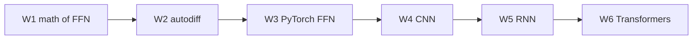
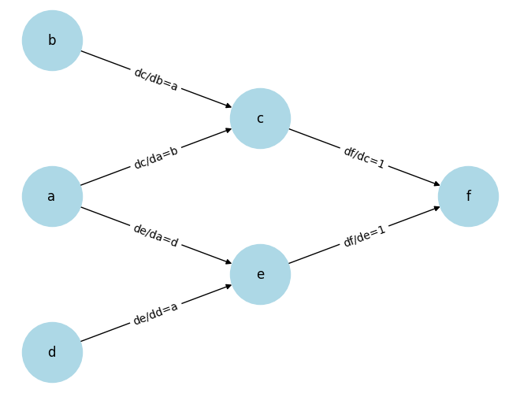
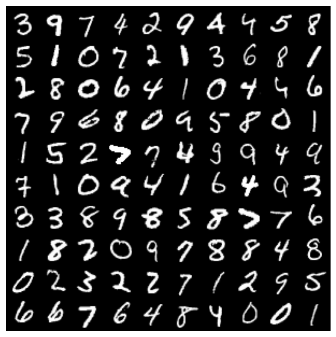
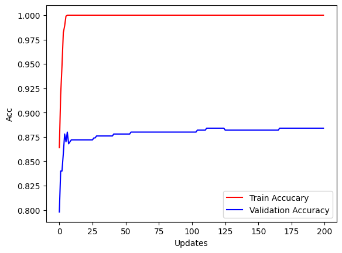
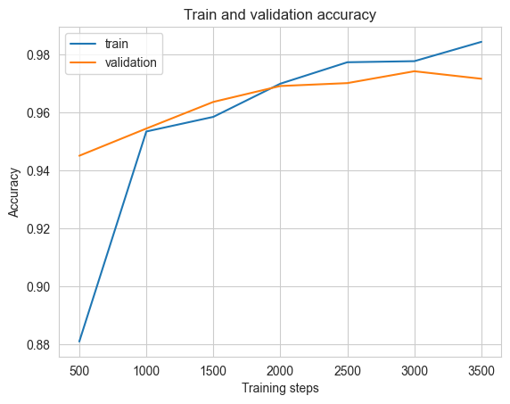
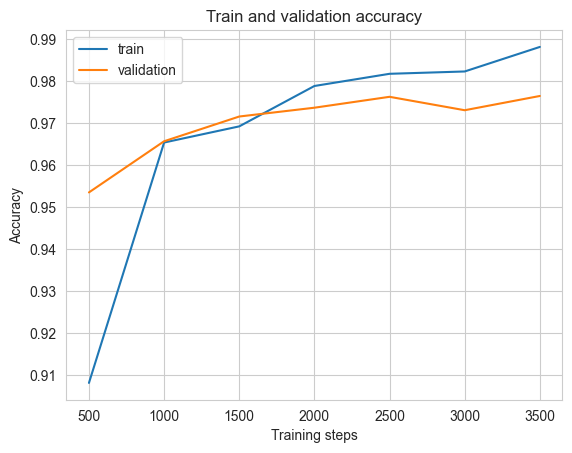
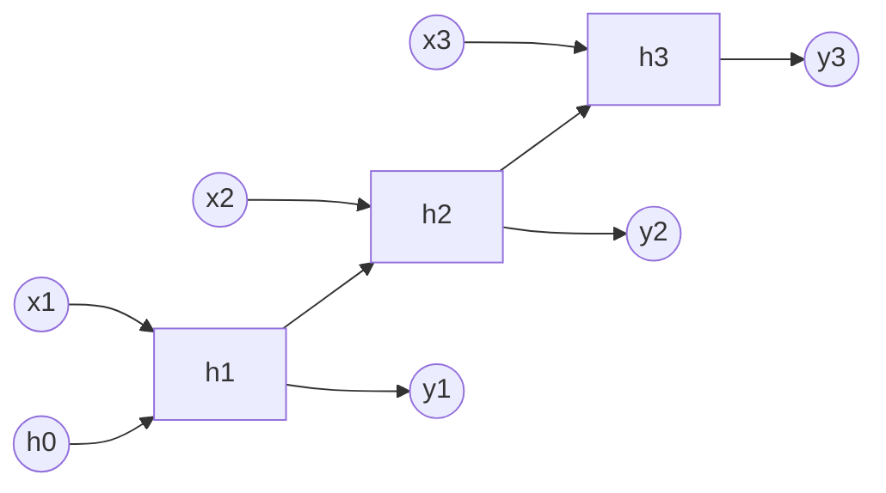
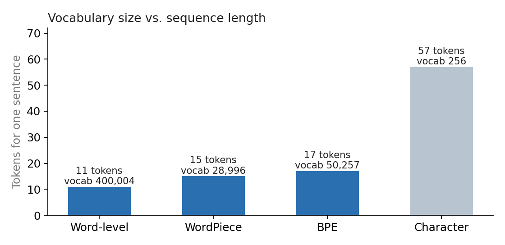
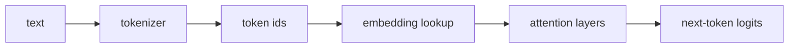

# 02456 Deep Learning (DTU)

Weekly notebooks from Week 1 to Week 6, plus the final-project briefs. This README is a map of **what I learned each week and what I can now do**. Figures come from my own saved notebook outputs.

## At a glance

| Week | Topic | What I learned | Evidence |
|---|---|---|---|
| 1 | Feedforward nets, pen and paper | Forward equations, losses, backprop on paper | Notebook placeholders unfilled |
| 2 | Autodiff with Nanograd | How a computation graph gives gradients | Hand-traced gradient `df/da = 14` matches the code |
| 3 | PyTorch basics, FFN | Tensors, autograd, init, optimizers, overfitting | Val acc 0.860 → 0.884 on an MNIST subset |
| 4 | Convolutional nets | Conv/pool arithmetic, adding a conv layer | Val 0.972 → 0.977, test 0.977 → 0.974 |
| 5 | Recurrent nets | One layer reused over time; hidden state | RNN forward test gives `[1, 3, 6]` |
| 6 | Transformers | Tokenizers, embeddings | 11 to 57 tokens for one sentence |

---

## Week 1: Feedforward networks on paper
**Notebook:** `week 1/1.1 FNN Pen and Paper.ipynb`

Topics: forward equations, loss functions derived from maximum likelihood, gradient descent, backpropagation.
My derivations are not in the notebook (its placeholders are blank), so I don't claim results here. If you have them on paper, add them.

---

## Week 2: Automatic differentiation (Nanograd)
**Notebook:** `week 2/2.1 FNN AutoDif Nanograd.ipynb`

### What I learned
- Each `Var` stores its **value**, its **gradient**, and its **parents with the local derivative** for each.
- `backward()` starts at 1.0 and multiplies local derivatives along each path back to the inputs.
- **Gradients add when a variable is used more than once.** For `f = ab + ad`, the variable `a` reaches `f` through two paths, so `df/da = b + d = 14`. The printed result `grad=14.0000` matches my hand calculation.

I labelled each edge with its local derivative (`dc/da = b`, `de/da = d`, `df/dc = 1`, ...). Multiplying along the path and summing over the paths gives the gradient.

### What I gained
A concrete picture of what PyTorch's `.backward()` does underneath. The later Nanograd sections (forward pass, cross-entropy, training) are still blank.

---

## Week 3: PyTorch basics and feedforward networks
**Notebooks:** `week3/3.1 What is pytorch`, `3.2 Automatic differentiation`, `3.3 FFN Half Moon`, `3.4 FFN MNIST`

### What I learned
- **Tensors ↔ NumPy share memory**, so changing one changes the other.
- **Autograd:** I derived the `d(out)/dx = 4.5` gradient by hand with the chain rule and confirmed it.
- **Non-leaf tensors have no `.grad` by default.** When `b.grad` and `c.grad` printed `None`, I used `.retain_grad()` to keep the gradient on `b`.
- **Shape of a dense layer:** `W` has `num_hidden` rows and `num_features` columns.
- **MNIST classifier changes:** He initialization, a second hidden layer, ReLU, and Adam.

### Result (1,000 train / 500 validation images, epoch 191 of 200)
| | Baseline (1 hidden layer, ELU, Xavier, SGD) | Modified (2 hidden, ReLU, He, Adam) |
|---|---|---|
| Validation accuracy | 0.860 | **0.884** |
| Training accuracy | 0.950 | 1.000 |

**Reading the curve:** training accuracy sits at 1.000 while validation stops at about 0.88. The model has memorized the small training set, which is overfitting. I changed all of these things at once, so I can't say which change caused the gain.

### What I gained
Comfort with PyTorch tensors and autograd, and a first real encounter with overfitting. Next steps are dropout, weight decay and batchnorm in 3.4, and the Half Moon notebook.

---

## Week 4: Convolutional networks
**Notebooks:** `week4/4.1 CNN Introduction`, `4.2 CNN CIFAR-10`, `4.3 CNN transfer`

### What I learned
- **Convolution and 2×2 max pooling by hand.**
- **Output size:** `out = floor((in + 2·pad − kernel) / stride) + 1`.
  - Example: `padding=2` with a 5×5 kernel keeps a 28×28 input at 28×28.
  - That size sets the input of the following linear layer.
- **Number of filters = number of output channels.**
- I added a 32-filter 5×5 conv layer (with padding) to the MNIST classifier and compared it with the feedforward baseline.

| Feedforward baseline | + one conv layer |
|:---:|:---:|
|  |  |

| (one run each) | Validation | Test |
|---|---|---|
| Feedforward | 0.972 | **0.977** |
| + conv layer | **0.977** | 0.974 |

Validation went up while test went down, by only 0.003 either way. **One run each cannot show that one model generalizes better.**

### What I gained
Confidence with convolution arithmetic and an awareness that tiny differences need repeated runs. 4.2 (CIFAR-10) and 4.3 (transfer learning) are not done yet.

---

## Week 5: Recurrent networks
**Notebook:** `week5/5.1 Recurrent Neural Networks.ipynb` · `week5/rnn_architecture.html`

### What I learned
- **Sequences as indices:** I wrote `sequences_to_dicts` to build token→index and index→token maps, and one-hot encoded the tokens.
- **One input layer and one recurrent layer are reused at every time step**, so the weights are shared across time.
- `forward_step` handles one time step; `forward_sequence` loops over the sequence and passes the hidden state along.
- The recurrent layer has **no bias**, because the input layer already provides one.

### A test I designed from scratch
With all weights set to 1 and identity activations, the hidden state is a **running sum** of the inputs, so inputs `[1, 2, 3]` must give `[1, 3, 6]`. The notebook printed `[1.0, 3.0, 6.0]`, matching the hand calculation.

### What I gained
I implemented `RNNLayer` in Nanograd by filling a template and verified it with a deterministic unit test. RNN training, LSTM and the backward test are still to do.

---

## Week 6: Transformers and language models
**Notebook:** `week6/6.1 Deep Learning with Transformers.ipynb`

### What I learned
- **Tokenizers trade vocabulary size against sequence length.**

  - A **word-level** tokenizer has a huge vocabulary (400,004) and maps unseen words to an unknown token (2 of the 11 tokens were unknown).
  - **Sub-word** tokenizers (WordPiece, BPE) split rare words into pieces, so they have no unknowns.
  - A **character-level** tokenizer has a tiny vocabulary (256) but a long sequence (57 tokens).
- **An embedding lookup is a matrix multiply:** looking up row *i* equals multiplying the one-hot vector for token *i* by the embedding matrix.

### What I gained
Understanding of the input side of every modern language model. The exercises on the language-model loss and attention masks are still to do.

---

## Final project
`finalProject/` holds the four 2026 briefs (PINNs, autoregressive, CYP, retrieval) and the report template. No project code or results are in this folder yet.

## Skills summary
- **Tools:** Python, PyTorch, NumPy, scikit-learn, Matplotlib, Hugging Face Transformers, Jupyter
- **Concepts:** backprop and autodiff, initialization (Xavier / He), SGD and Adam, convolution arithmetic, RNN hidden state, tokenization and embeddings
- **Habits:** verify a gradient by hand, check train-vs-validation curves, treat one run as weak evidence, write tests with known answers

## Still to fill in
- Week 1 derivations.
- Weeks 3.3 and 3.4 regularization, 4.2 CIFAR-10, 4.3 transfer learning, 5.1 training and LSTM, 6.1 attention exercises.
- Final project choice, my contribution and results.
